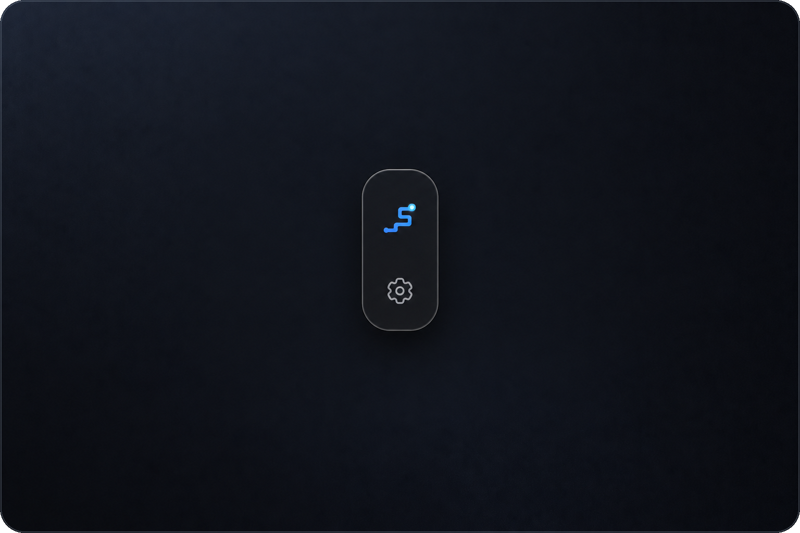
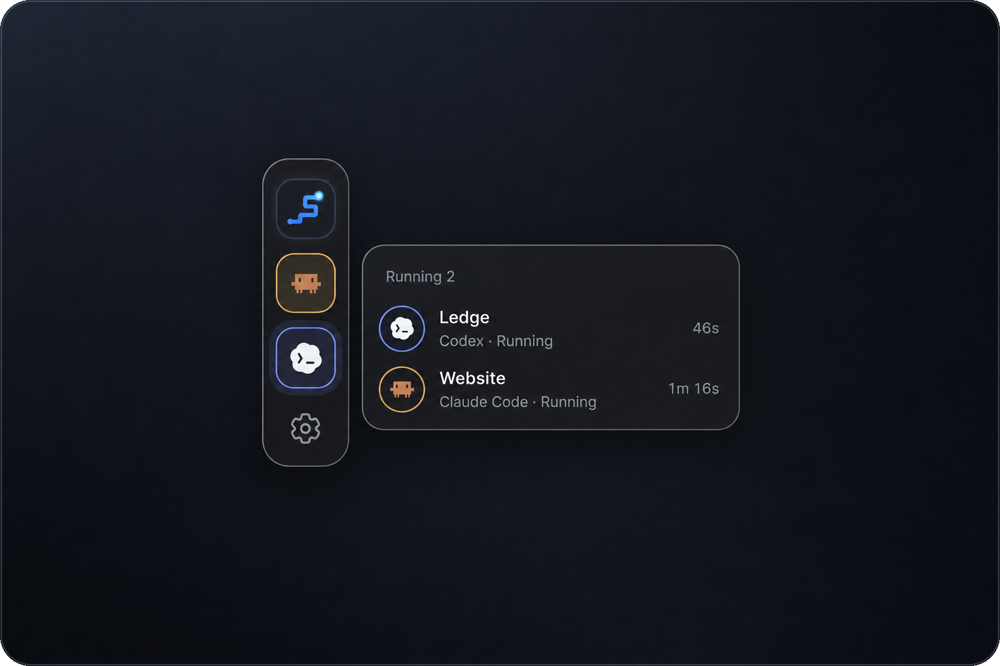
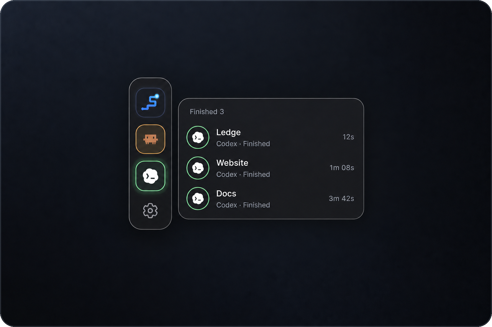
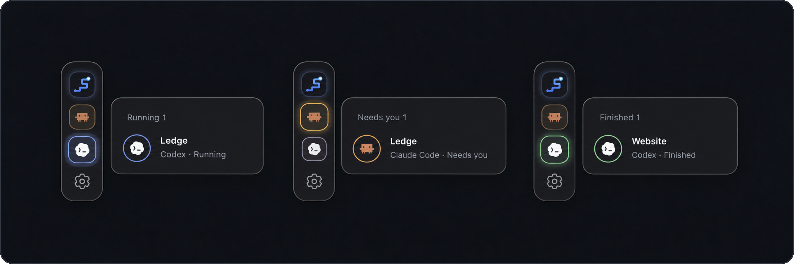

# Ledge

A small Mac widget that shows when Claude Code or Codex is working, waiting
for you, or finished. It only sees sessions running on your own Mac.

<p align="center">
  
</p>

## Install

You need a Mac with Apple silicon (M1 or newer) running macOS 11 or later.

Open the **Terminal** app, paste this line and press Return:

```sh
curl -fsSL https://raw.githubusercontent.com/smokey18/Ledge/main/scripts/install.sh | sh
```

This puts Ledge in your Applications folder.

<details>
<summary>Install without Terminal</summary>

1. Download the `.dmg` file from the [latest release](../../releases/latest).
2. Open it and drag Ledge into Applications.
3. The first time you open Ledge, macOS blocks it because it isn't from the
   App Store. Go to **System Settings → Privacy & Security** and click
   **Open Anyway**.

</details>

## Use

Open Ledge before you start Claude Code or Codex, so it can see your sessions.

- Click an agent's icon to see its sessions.
- Click a session to open its project folder in Finder.
- Turn on **Open at login** in Settings, then click **OK** when macOS asks.
- Use the Ledge icon in the menu bar to hide, show or quit Ledge.

<p align="center">
  
  
</p>

<p align="center">
  
</p>

## Development

Requires Rust and Node.js 20 or newer.

To check a downloaded `.dmg` is genuine:

```sh
gh attestation verify Ledge_*.dmg --repo smokey18/Ledge
```

To run, build and test:

```sh
npm install
npm run tauri dev
npm run tauri build
cd src-tauri && cargo test
```

## License

[MIT](LICENSE) - Claude and OpenAI marks belong to their respective owners.
